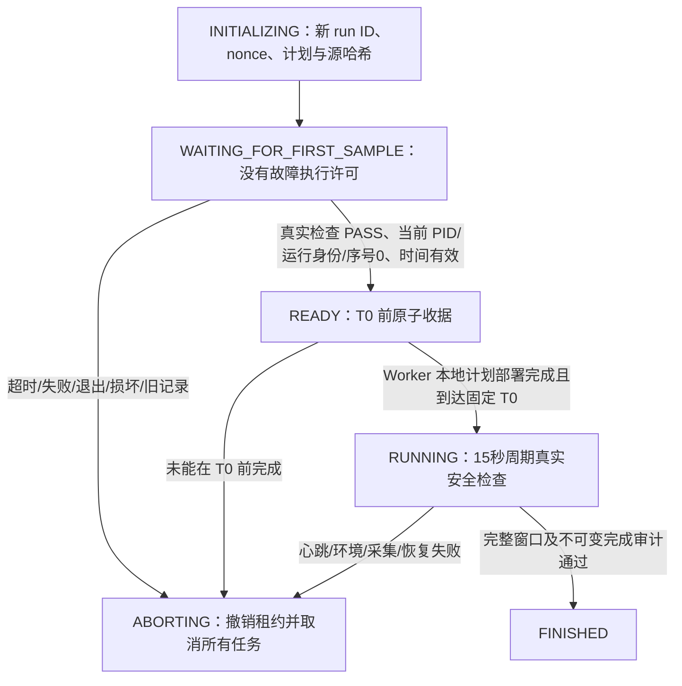

# ATTEMPT-03 控制器与观察器启动协议

Master UTC 决定不可移动的 T+0。计划在启动控制器前保存 UTC 时间，预启动准备期为 150 秒；首心跳预算为 15 秒，连续检查周期 15 秒，运行中新鲜度上限仍为 30 秒，故障开始偏差仍为 2 秒。

心跳由真实观察器检查 Kubernetes、Prometheus、OpenSearch、Collector、目标身份与容量后产生。不可变序号样本先完整写入，再原子替换 heartbeat.json；控制器校验 run_id、run_token、plan_sha256、producer_sha256、实际 systemd MainPID、序号、完整检查摘要及时间戳。重复读取同一份未变样本允许，但同序号内容改写、序号倒退、未来或过期时间、旧 attempt、损坏格式全部拒绝。历史序号文件在联合验证时逐项检查完整性和连续性。

预启动心跳位于数据盘独立控制目录，不进入正式 Metrics/Logs/Traces 窗口。观察器必须在 T0 前收到相同计划与运行身份的 READY 收据，才能启动定时业务负载。T0 不因初始化滞后而后移。

控制器在 READY 前不签发 Worker 租约。正式故障还需各自新鲜 baseline、安全检查和对应 authorization。租约最长4秒；观察器退出或安全失败后不续租，并立即撤销和取消两个预部署任务。原独立适配器回滚定时器仍有效。

联合验证使用同一版控制器和观察器，独立的 300 秒无故障运行和外部 SIGTERM 退出测试；后者在 T+30 秒终止观察器，控制器必须通过正常故障检测分支自行停止，不能靠测试程序伪造终态。两个 marker 只记录时间，任何真实业务故障均禁止。
