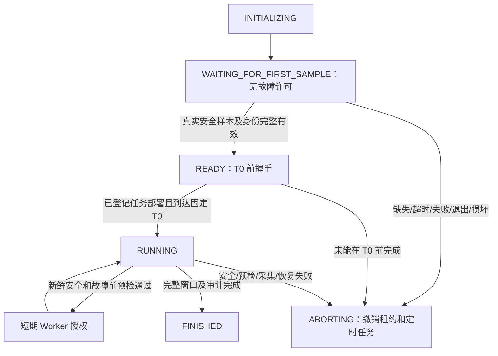

# SF-PILOT-01 ATTEMPT-03：启动握手修复、联合验证与试生产报告

**最终状态：SF_PILOT_01_BLOCKED。实际业务故障注入 0 次。不能导入比赛服务器。**

启动竞态已在真实观察器中修复并验证；5 分钟无故障联合演练及异常退出取消测试均通过。但唯一的新正式尝试在首次故障前，被预检中的旧调度文件名误判阻断，实际观察约 **634.319 秒（10 分 34 秒）**。这属于本轮集成遗漏，不是已证实的 Collector、业务或节点安全故障。没有修改失败决定，没有自动启动 ATTEMPT-04。

## 1. 执行范围与结果

| 阶段 | 实际结果 | 说明 |
|---|---|---|
| A：原启动竞态及旧资产检查 | 已执行 | ATTEMPT-01/02 保持原样 |
| B：显式启动握手 | 已实现、真实环境验证通过 | T0 前真实首检查、身份/序号/PID/时间戳/摘要校验、原子写入 |
| C：联合回归 | 本地 32/32、Master 32/32 PASS | 含子进程原子文件发布；不等于全部正式分支已覆盖 |
| D：300 秒无故障联合演练 | PASS | 同版控制器与真实观察器，3,562/3,562 请求匹配 |
| D：外部终止观察器测试 | PASS | 正常检测分支自行发现退出并取消两个 pending marker |
| E：新鲜生产前环境检查 | PASS | UID/进程、Collector hash、时钟、存储、五主机、无残留 |
| F：ATTEMPT-03 独立登记 | 已执行 | 独立计划/种子/哈希/固定 UTC 窗口 |
| G：正式试生产 | BLOCKED | T+10:34 中止，Service/Pod 都未注入 |
| H：Public / 异常 GT | 未执行 | 未完成合格一小时，不输出空包或虚构标签 |
| I：失败证据双副本归档 | PASS | SHA-256 及已有三模态样例恢复读取通过 |
| 新正式尝试 | 未执行 | 无 ATTEMPT-04，无比赛服务器访问 |

## 2. 初始化竞态修复与握手流程

新代码：`/root/ops-competition-2026/attempt03-20261014/scripts/`。旧文件不修改。

计划预先确定 Master UTC T0。首样本预算固定为 15 秒，心跳周期 15 秒，运行期间仍执行原 30 秒 freshness；故障启动容差仍为 2 秒。预启动准备期固定 150 秒，不能因准备不足后移 T0。

1. 控制器创建当前 run ID、随机 run token、计划 hash 与源 hash 绑定的运行记录。
2. 真实观察器先检查 Kubernetes、Prometheus、OpenSearch、Collector、UID/容器/节点、磁盘和安全余量。
3. 完整的不可变序号心跳写入后，原子替换 `heartbeat.json`；预启动记录保存在数据盘私有 control 目录。
4. 控制器验证 run ID/token、计划和观察器源 hash、实际 systemd MainPID、首序号 0、检查摘要、时间戳及 freshness。
5. 在 T0 前写入 READY receipt；观察器确认同一运行和计划后，才启动固定时刻的正式负载。
6. RUNNING 后持续检查相同安全条件。等待、旧记录、部分文件、异常时间、失败检查或观察器退出都不授予故障租约。
7. 故障还需要新的 baseline、五主机预检及独立 watchdog 授权。异常停止即撤销租约、取消两个后续任务。

原 `competition_adapter.py` 和 duration+5 秒独立恢复代码保持不变；Collector 配置 SHA-256 保持 `128ed286e8a959aacddc2ee6c00e2d6e8b0a3eb18ea43e5de730a20e3793af2d`。本轮没有调优 Collector、修改业务服务或网络。

## 3. 单元与联合测试

32 项回归包含正常/延迟/永不到达首心跳、实际安全失败、旧 attempt、过期/未来/异常时间、观察器退出、运行中 stale、T0 前未 READY、重复读取与重复改写、错误 PID、序号倒退、损坏记录、子进程原子发布，以及既有 lease/hash/取消相关逻辑与数据格式回归。

真实演练 ID：`A03-NOFAULT-INTEGRATION`。

- 300 秒正常业务，MEDIUM 1.4 sessions/s；Image 1/s、Cart 2/s，配置不降频。
- 首次检查 **0.631 秒**；完整启动握手 **0.833 秒**。
- 49 条控制心跳，序号与身份完整，最大间隔 15.741 秒；40 个 T0 后安全样本包含补齐审计期。
- 2,662 条业务请求、Image 300、Cart 600 全部成功；总计 **3,562/3,562** 完成请求匹配实际 Proxy Span，未解释缺失为 0。
- 业务会话完成 420，successful_sessions 415；请求成功率为 100%，不将会话成功率写成 100%。
- Trace 首次 72,513，+60/+120/+240 均 72,585；Logs 49,507。
- 完成时延分别 18.574 / 68.279 / 127.991 / 249.898 秒，全部在既定截止时间内，+240 无新增迟到 Span。
- Collector refused 无增量，采样工作集峰值 317.87 MiB。
- Worker2/Worker3 无害 marker 启动偏差约 0.277 / 0.274 秒，计入时钟不确定度均不超过 0.311 秒；控制器反馈上界约 0.714 / 0.752 秒。

异常退出演练 ID：`A03-OBSERVER-EXIT-TEST`。

- 同版观察器真实首检查 0.676 秒，握手 0.841 秒。
- 独立测试程序按预登记 T+30 秒，在 05:39:54.713227 UTC 对测试观察器发送 SIGTERM；没有暂停业务进程。
- 控制器通过正常 `OBSERVER_ABORT` 分支自行中止；Worker2 / Worker3 分别于 05:39:55.249497 / 05:39:55.331105 取消任务，距刺激约 0.536 / 0.618 秒。
- 两个未来 marker 均没有 actual_start、marker 或执行终态。清理后环境检查通过。
- `expected_exit_test_observed` 内部字段属于未使用的内置测试分支，本次使用独立外部退出刺激；正式验收依据保留的外部触发记录、实际 `OBSERVER_ABORT`、取消记录和无执行证据，不覆盖内部字段。

验收文件：`/root/ops-competition-2026/attempt03-20261014/results/joint-rehearsal-verdict.json`，状态 `JOINT_REHEARSAL_PASS`。

**测试缺口：** 这两项验证覆盖握手、心跳、负载、采集、marker 和退出取消，但无故障分支没有调用正式故障前的 timer allowlist 预检。因此不能说它们验证了所有正式控制分支。本次遗漏由此未能在真实尝试前发现。

## 4. ATTEMPT-03 登记与实际执行

计划：`/root/ops-competition-2026/plans/SF-PILOT-01-ATTEMPT-03.json`。

SHA-256：`4c47c7015fbdaa74df90dc5b2ebaf60176fcddcc80a110d1c9386ed797736b48`。

随机种子 1013100；无故障演练种子 1009100、退出测试种子 1011100，分离且不复用旧运行身份。

| 项目 | UTC |
|---|---|
| 固定正式窗口 | 05:44:53.440750 → 06:44:53.440750 |
| 计划 Service 故障 | 05:56:53.440750 → 06:01:53.440750 |
| 计划 Pod 故障 | 06:19:53.440750 → 06:24:53.440750 |
| 真实观察器停止 | 2026-10-14T05:55:27.760002+00:00 |
| 控制器终态完成 | 2026-10-14T05:55:46.452678+00:00 |
| 故障实际启动偏差、持续时间、恢复 | N/A：两个故障都未触发 |

正式握手用时约 0.835 秒，首次检查约 0.635 秒。跨过 T0 后正常采样，没有再次出现 ATTEMPT-02 的首心跳竞态。

## 5. 此次阻断的根本原因

故障前检查返回：

- `w2_no_other_competition_timer`
- `w3_no_other_competition_timer`

新控制器实际写入：

- `plans/scheduled-SF-PILOT-01-ATTEMPT-03-service.json`
- `plans/scheduled-SF-PILOT-01-ATTEMPT-03-pod.json`
- `plans/schedule-lock-SF-PILOT-01-ATTEMPT-03.json`

但 `scripts/attempt_preflight.py:107–110` 仍读取：

- `plans/scheduled-service.json` / `scheduled-pod.json`
- `plans/schedule-lock.json`

这些旧名称文件不存在，导致 registered timer 集合为空。实际存在的本轮合法 unit：

- `ops-a03-sf-pilot-01-attempt-03-service.timer`
- `ops-a03-sf-pilot-01-attempt-03-pod.timer`

因此被误判为“其他实验残留”。这是本轮代码路径适配遗漏，安全检查按 fail-closed 原则停止正确；不能关闭检查或将该失败伪改为 PASS。

故障前预检快照：`/data/stage5-v3/ops-competition-2026/audits/COMP-SF01-A03-SERVICE-PREFAULT/`。

两个 Worker 的对应 injection state 和 injection output 均不存在；timer 已取消。没有为获得结果而忽略门禁或再次试生产。

## 6. 实际保留的数据与质量范围

正式观测实际持续 **634.319252 秒**。没有完整 60 分钟数据。

| 分段 | 初次 Metrics 样本 | 初次 Logs | 初次 Spans | 完成审计 |
|---|---:|---:|---:|---|
| chunk-00，前 5 分钟 | 7,140 | 52,376 | 72,516 | +60/+120/+240 均 72,549；CHUNK_QUALITY_PASS |
| chunk-01，第 5–10 分钟 | 7,140 | 49,918 | 71,616 | 仅初次采集完成，后续因中止未完成 |

数字是对应原始版本记录量；不把多个 Trace 版本相加冒充独立 Span，也未做正式 Public 去重/导出。Metric query 端点可能重复保留，以上是 raw 样本数。

chunk-00 的成熟前缀 **3,527/3,527** 请求匹配，未发现迟到 critical Span。不能把该前缀结果推广到全部中断窗口。

中止前完成记录：业务 **5,603/5,603 成功**，对照 **1,904/1,904 成功**。未完成请求在中止时的数量为 UNKNOWN，不能仅从完成记录推算所有已发请求。全窗口最终请求/Span 匹配未完成，不宣告全部完整。

43 次正式安全采样中 Collector refused 无增量，工作集峰值 **321.28 MiB**。保存的运行日志未检出 error/refusal/timed-out/OOM 候选行。缺失的 exporter retry/failed 指标保持 UNKNOWN，不补造 0。Collector 配置未变。

另发现 Prometheus query_range 会把微秒边界舍入到毫秒。已保留独立导出器实现修正草案，按原 `[start,end)` 规则排除最多 1 ms 的窗口外查询端点并计数，不移动时间戳、不改 raw。**本次没有执行正式导出**；该草案不是 Public 质量通过的证明，原注册 exporter 未修改。

## 7. Private / Public 与异常标注

- Public 六件套：**未生成**。
- 异常候选和异常 GT：**未执行标注**，不能描述为“观测到 0 个异常”。
- 私有注入计划保留，但仅是预注册计划，不能当作异常 GT。
- 不基于计划时间伪造异常边界，不拼接历史实验，不生成评分答案。
- 未连接或操作 `192.168.51.50`、`192.168.51.51`；不具备导入条件。

## 8. 最终安全、恢复与历史保护

最终只读检查时间：2026-10-14T05:57:45.049993+00:00；`COMPETITION_ENVIRONMENT_PASS_WATCHDOG_PENDING`，实际环境 blocker 为 0。

4 Kubernetes 节点 Ready，五主机资源、Calico/网络、CoreDNS、关键业务和监控状态通过，无暂停进程、内存 holder 或活动的本轮 timer。因未注入，故障恢复指标为 N/A，不拿历史资格证明代替实际恢复结果。

原始 Global Safety 的独立 watchdog 项仍为 PENDING，最终检查不签发新的故障许可；保留其 raw 状态，不覆盖成可注入 PASS。其他实际环境项通过。

Master 根盘可用 46,108,880,896 bytes；数据盘可用 288,373,108,736 bytes，UUID `a35051a2-3d09-4b83-bbc0-3bb055e8a4f3`。未降低安全容量阈值，大型原始和心跳数据保存在数据盘。

本次注册源 hash 改动数为 0。旧报告 SHA 保持：

- ATTEMPT-01：`45aadba7eb5cf53d79bb9b8bb6c82078da1ded631a47d8b233a8d81307bd6a4b`
- ATTEMPT-02：`095d11d1ef10cc9a1956bda8e1f04d94491747c72faebe34426d419027b6bd53`

Stage5-v1/v2/v3 冻结科研产物不修改，TEST 未访问。

## 9. 草案修复与尚未验证项

草案：`/root/ops-competition-2026/attempt03-followup-draft-20261014/`。

采用显式传递的 schedule-lock 和 run ID 作为唯一调度登记来源，逐项校验文件路径、SHA、run ID、Worker、机制范围和 unit，禁止再推测旧文件名。未知 timer、错误 hash、错运行或错 Worker 继续拒绝。

8 项单元测试通过；对保存的实际失败快照进行只读重放，正确识别两台 Worker 的本轮合法 timer，unexpected 集合为空。该结果只是修复逻辑诊断，**不替换原 admission/终态，不向运行环境授予许可**。

下一步应先统一 dry-run 与正式流程的外层执行分支，完整覆盖：预部署 timer 仍为 pending 时的正式故障前预检、baseline 前缀、授权/租约、执行反馈、撤销、恢复检查及数据审计；仅替换实际故障动作为无害 marker。修复后的完整实时联合验证尚未执行，不能宣告 ATTEMPT-04 或新正式生产就绪。

## 10. 双副本归档

两台 Worker 的共同归档根：
`/data/rca-archives/ops-competition-2026/SF01-ATTEMPT03-BLOCKED-20261014/`。

Master 索引：
`/data/stage5-v3/ops-competition-archive-index/SF01-ATTEMPT03-BLOCKED-20261014/result.json`。

| 归档部分 | 文件数 | Bytes | Worker2 / Worker3 | 源清单 SHA-256 |
|---|---:|---:|---|---|
| raw | 609 | 1,273,727,315 | PASS / PASS | `ab96239994dd56fef087fd8aa08addcefe43323eedca5aae60dcc1f7cc31acef` |
| rehearsal | 448 | 981,898,567 | PASS / PASS | `8131381238501e0b3ba751ce8e37a3ff65e9c50d9e3e7b229381cb1405d781ec` |
| exit-test | 23 | 1,032,089 | PASS / PASS | `596c08067fa7c4f87fa175fb4d7fc572cc5fcce124f9c8903fb160dcc09b2863` |
| runtime | 171 | 90,857,861 | PASS / PASS | `41634240788185396d243e0430d082576fbc466a1953069ba7853a6686cecb31` |
| control | 55 | 2,761,622 | PASS / PASS | `9677de340d563324fd5b41c871ed5354374d8621d6c306bd4e086f02f22fd7ae` |
| delivery-tools | 8 | 32,586 | PASS / PASS | `11a4739d28eec76f94326ade97f16d4534a86a9214f8250a258f01ad026ec894` |
| followup-draft | 5 | 6,003 | PASS / PASS | `30c2f87f5fc1e3ed7ba5b0292ef0c7c6630b61773ff65c2e58da2c5a08101335` |

所有现有文件逐项 SHA 一致；正式 raw 和无故障 rehearsal 的已有 Metrics/Logs/Traces 样例恢复读取通过。这只证明已保存证据可恢复，不代表正式 60 分钟已采齐。大包未落地 Mac。

## 11. 交付索引

- 报告：`/root/ops-competition-2026/reports/SF-PILOT-01-attempt03-report.md`
- 完整源码、计划清单、回归及故障摘要：`/root/ops-competition-2026/attempt03-20261014/`
- 主计划：`/root/ops-competition-2026/plans/SF-PILOT-01-ATTEMPT-03.json`
- 计划 manifest：`/root/ops-competition-2026/attempt03-20261014/plans/SF-PILOT-01-ATTEMPT-03-manifest.json`
- 无故障联合验证：`/root/ops-competition-2026/attempt03-20261014/results/joint-rehearsal-verdict.json`
- 正式原始数据：`/data/stage5-v3/ops-competition-2026/runs/SF-PILOT-01-ATTEMPT-03/`
- 心跳、握手、控制器终态、撤销、Worker 证据：`/data/stage5-v3/ops-competition-2026/attempt03-control/SF-PILOT-01-ATTEMPT-03/`
- 无故障演练：`/data/stage5-v3/ops-competition-2026/runs/A03-NOFAULT-INTEGRATION/`
- 退出测试：`/data/stage5-v3/ops-competition-2026/runs/A03-OBSERVER-EXIT-TEST/`
- 最终环境检查：`/data/stage5-v3/ops-competition-2026/audits/COMP-SF01-A03-FINAL-READONLY/`
- 只读 timer 修复草案：`/root/ops-competition-2026/attempt03-followup-draft-20261014/`
- Public/异常 GT：未生成。

最终 **SF_PILOT_01_BLOCKED**。已停止，等待人工审核；没有自动启动 ATTEMPT-04。
