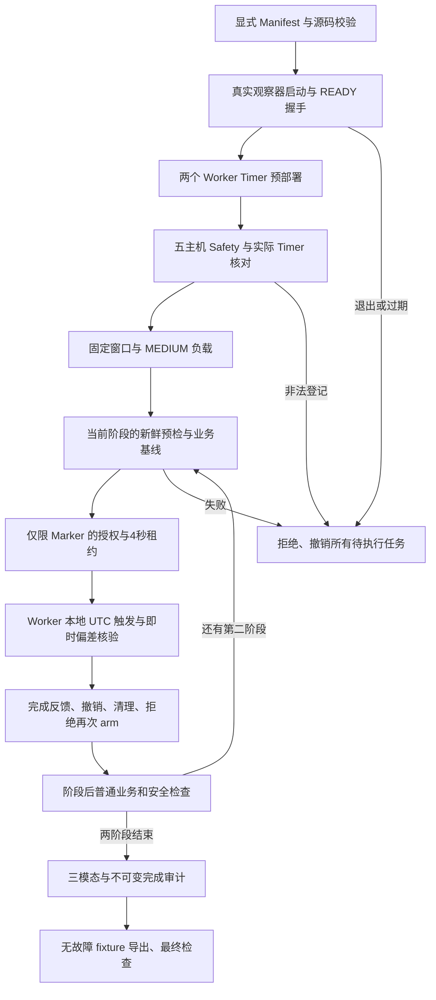

# SF-PILOT-01：Pre-ATTEMPT04 工程修复与全流程 Dry-run

**最终状态：PRE_ATTEMPT04_READY。建议进入 ATTEMPT-04 的人工确认和新计划登记阶段。**

本结论仅针对工程控制流程、无故障采集和基础导出兼容性。本轮真实业务故障为 **0 次**，没有创建 ATTEMPT-04 正式 Case、正式 Public 题目包或异常 GT，未访问比赛数据服务器。Marker 成功不等于真实 Service/POD 故障恢复已验证。

## 1. ATTEMPT-03 原因与修复

ATTEMPT-03 的控制器生成了包含 run_id 的调度文件和 lock，但 `attempt_preflight.py` 仍查找旧固定文件名，导致合法 pending Timer 被误判为残留。此前无故障分支跳过了正式故障前预检，未提前发现这一遗漏。

本轮以 `run_registry.py` 实现唯一、显式的运行登记来源：所有控制器、观察器、预检和 Worker 入口接收同一个 Manifest 路径与 SHA-256，不再猜测合法 Timer 文件名。

Manifest 绑定 run_id、计划路径/hash、schedule-lock 路径/hash、Worker、机制 ID、目标及 UID、预定 UTC 时间、unit 名、登记文件、执行/撤销动作。预检同时核对真实 systemd unit 的 Worker、执行 argv、原始微秒截止时间、AccuracySec=10ms、无随机延迟及 Persistent=false。未登记、历史运行、错误 Worker、错误 hash 或不同命令均拒绝。

发现 `systemctl show` 的可读时间会省略微秒后，改用 systemd D-Bus 的 `NextElapseUSecRealtime` 原始整数核对；没有放宽时间精度或原 2 秒启动容差。

旧 ATTEMPT-03 快照已只读重放：两台 Worker 的真实命令与当时登记文件/hash 精确匹配，确认它们属于该运行。历史快照未保存 typed 微秒 timer 属性，因此该重放仅证明历史身份绑定，不伪造完整历史时间属性验证；原失败决定保持不变。

## 2. 代码与共用控制流程

代码目录：`/root/ops-competition-2026/pre-attempt04-20261014/scripts/`。

| 模块 | 本轮职责 |
|---|---|
| run_registry.py | 唯一 Manifest/plan/lock/action 校验与实际 Timer 核对 |
| pilot_controller.py | 两个阶段共用的初始化、预检、基线、授权、反馈、撤销和收尾流程 |
| pilot_observer.py / handshake.py | 真实首心跳握手、运行身份与序号、连续安全检查、固定窗口采集 |
| marker_worker.py | 独立无害能力入口，仅写时间 Marker 并检查短期租约 |
| attempt_preflight.py / master_refresh_safety.py / timer_inventory.py | 新鲜五主机门禁、精确登记核对和 D-Bus 实际属性读取 |
| business_gate.py | 普通业务 UID 级基线与阶段后健康观测 |
| pilot_boundary_guard.py / boundary_empty.py | 严格核验窗口外辅助查询的真实空结果 |

代码差异和源 hash：`/root/ops-competition-2026/pre-attempt04-20261014/results/final-code-differences/`。

没有给 Marker 跳过故障前预检的旁路。两个阶段使用同一外层流程和登记解析模块。Dry-run 入口强制 `SFDRY-*`、`formal_case=false` 及 `HARMLESS_LOCAL_TIME_MARKER_V1`；Worker 代码不导入真实适配器、不接受任意故障命令、不操作业务 PID/cgroup/网络配置。不能通过普通布尔开关切换为真实故障。

首心跳预算仍为 15 秒，周期 15 秒，新鲜度上限 30 秒；短期租约 4 秒；原 2 秒启动容差不变。当前工程入口不授予真实故障权限，正式入口仍需人工确认后的专用能力和独立运行计划。

## 3. 回归与负向验证

**本地和 Master 最终各 52 项回归通过。** 结果在 `results/local-regression-v3.json`、`results/master-regression-v3.json`。

覆盖合法 Service/POD Timer、两台同时 pending、未登记/旧运行 Timer、错误 run_id/路径/hash/Worker/命令/时间、取消后禁止重新 arm、首心跳缺失/延迟/异常/过期、观察器退出、过期或不安全租约、真实故障权限拒绝、2 秒容差、时间与身份格式、原子发布，以及辅助查询空结果的严格验证。

真实负向 `SFDRY-NEG-03` 使用错误 schedule-lock SHA：预检报告 `REGISTRATION_FILE_HASH`，在签发任何租约前拒绝，两个 pending Timer 均取消，无 Marker 启动。保留 `DRY_RUN_FAILED` 原始终态，验收将其解释为**预期拒绝成功**，未改写原记录。

额外真实退出测试 `SFDRY-EXIT-01`：两个合法 Timer 均经实际预检后，独立程序对本轮观察器发送 SIGTERM。控制器通过正常退出检测分支中止，约 **0.635 / 0.761 秒**内完成两台 Worker 的撤销；未产生租约或 Marker。见 `results/observer-exit-verification.json`。

## 4. 演练历史与新缺陷处理

| 运行 | 实际结果 | 保留内容 |
|---|---|---|
| SFDRY-NEG-01 | 错误 hash 按预期拒绝 | 同时发现可读 timer 时间丢失微秒的问题 |
| SFDRY-NEG-02 | 错误 hash 拒绝、清理通过 | D-Bus 微秒属性与有效登记的只读核对通过 |
| SFDRY-FULL-01 | 两阶段完成，但末段审计中止 | 窗口外 1 秒查询为 0，旧读取器误报；未补写原 capture |
| SFDRY-NEG-03 | 最终版本错误 hash 拒绝通过 | 无授权、无 Marker，全部撤销 |
| **SFDRY-FULL-02** | **完整 15 分钟流程与数据审计 PASS** | 本轮最终验收数据来源 |
| SFDRY-EXIT-01 | 真实观察器退出取消测试 PASS | 无真实业务故障 |

FULL-01 暴露的是**窗口外辅助证据**为空，并非主窗口无 Trace。修复后只在索引/UUID/映射有效、分片成功、无超时且精确计数为 0 时记录真实空结果；非空仍调用原读取器，超时/失败/未知计数继续失败。正式窗口要求、请求匹配与 +5/+60/+120/+240 截止规则未放宽。

FULL-02 已在实时采集中实际走过该空结果分支，并完整通过后续审计。旧失败运行、诊断和源码版本保留在 `versions/`、`results/full01-empty-outside-diagnosis.json`；诊断回溯不是替换采集。

## 5. 完整无故障联合演练

最终运行：**SFDRY-FULL-02**。

- 固定窗口：2026-10-14 **07:47:24.803995—08:02:24.803995 UTC**，即北京时间 15:47:24—16:02:24，共 900 秒。
- 随机种子：2014100；MEDIUM 1.4 sessions/s，Image 1/s，Cart 2/s。三个阶段策略不变。
- Manifest SHA-256：`97d0bc3709824dcba30820da668f5660c6775b78ccbb1248b0b9cb3e713cdcea`。
- 两个 Marker 分别 T+660、T+840 秒执行，持续 10 秒；不是 300 秒真实故障。

| 阶段/Worker | 实际启动 UTC | 原始偏差 | 含不确定度上界 | 反馈上界 | Marker 时长 | 全阶段 |
|---|---|---:|---:|---:|---:|---|
| SERVICE / Worker3 | 2026-10-14T07:58:25.057612+00:00 | 0.253617 s | 0.297655 s | 0.405170 s | 10.025 s | PASS |
| POD / Worker2 | 2026-10-14T08:01:25.042291+00:00 | 0.238296 s | 0.266162 s | 0.100822 s | 10.027 s | PASS |

两阶段均实际完成新鲜五主机预检、UID 级普通业务基线、Timer 检查、授权、短期租约、启动反馈、完成反馈、撤销、清理、取消后再次 arm 拒绝以及阶段后健康检查。第一次预检要求两个 Timer 都 pending，第二次要求剩余 POD Timer pending，已清理的第一任务未被当作需重启对象。

Service 基线中的两个 Recommendation UID 分别有 **70、49** 条 Trace；Pod 基线中的两个 Frontend UID 分别有 **467、499** 条 Trace，均超过原 10 条要求。未使用定向 Pod 诊断流量代替普通业务覆盖。

结果：`/root/ops-competition-2026/pre-attempt04-20261014/results/SFDRY-FULL-02-assessment.json`，`DRY_RUN_ENGINEERING_PASS`，失败检查为空。

## 6. 心跳、租约、三模态和 Collector

- 90 条心跳身份/序号完整；最大间隔 **15.753 秒**。80 次 T0 后安全采样包含补齐审计阶段。
- 270 条授权续约记录均绑定同一 Manifest、当前 action 和心跳，只允许 Marker，TTL 不超过 4 秒；最终全部撤销或过期。
- **10,689/10,689** 预期已发请求匹配真实 Proxy Span；未解释缺失为 0，所有请求成功。
- Image 900/900、Cart 1,800/1,800，无漏调度。
- 三个 5 分钟分段全部 `CHUNK_QUALITY_PASS`；四次完成审计均在既定预算内，+240 无新增 critical/未分类迟到 Span。
- Collector refused 无增量；采样工作集峰值 **327.97 MiB**，低于原 380 MiB 上限。
- 已验证 Collector 配置 SHA 不变：`128ed286e8a959aacddc2ee6c00e2d6e8b0a3eb18ea43e5de730a20e3793af2d`。验证时段日志未检出 error/refused/timeout/OOM 候选。未暴露的 retry/failed 计数保持 UNKNOWN，不当作 0。

## 7. 导出器兼容性：仅工程 fixture

产物：`/data/stage5-v3/ops-competition-2026/pre-attempt04/fixtures/SFDRY-FULL-02/`。标记 `fixture=true`、`formal_case=false`、case ID 为 SFDRY，**不是正式 Public 题目包**。

| 项目 | 实测结果 |
|---|---|
| Metrics | 19,740 行；全部窗口内原始样本保留 |
| 窗口外查询端点 | 987 个，均显式计数，原始查询保留 |
| Logs | 149,183 行；其中 125,895 行含微秒以下精度 |
| Traces | 218,935 Span，31,623 Trace |
| Trace/Span ID | 与源数据原表示逐项一致 |
| Pod UID | 101,571 条 Span 的原有 UID 精确保留，均能在采集拓扑找到 |
| Parquet 时间 | UTC timestamp[ns] 往返通过，不移动时间戳 |
| Manifest / schema / 文件 hash | PASS |

查询窗口仍为 `[start,end)`。只排除因 Prometheus 毫秒舍入而落在窗口外的端点，未删除窗口内样本，没有把 timeout、缺失或未知值伪造为 0。

字段覆盖保持透明：其余 Span 原本未提供 Pod UID，未猜填；645 次系列元数据查询项没有可用指标类型元数据，保留 NULL；11,038 个父引用在窗口内无对应父 Span，保留 unresolved。51,435 条携带 Trace ID 的日志均能关联到导出的 Trace。不能把原始字段缺失隐去或宣称完整调用树全部闭合。

Fixture Manifest SHA-256：`5fd9fcd3a21ad44ad18032e8550e6dd875560243022de4273d576239090a97f0`。

| 文件 | Bytes | SHA-256 |
|---|---:|---|
| logs.parquet | 5,501,805 | `5742f2720420c883706ecf5c0b42b4953850a72d58acef209a79d05d2368f242` |
| metrics.parquet | 107,642 | `68f72d56669f8d3b96734fd53c2c78e5aa8fc6c791825d64a158281d274f1e39` |
| topology.json | 64,962 | `13709de36c0662f25b5de50e9f6b666c212e8d19e8d45ad487dbbd1719b4c099` |
| trace_index.parquet | 1,040,234 | `3a479f0122d826669e82dc6949f560d7d9e6654ab5c3e12b2f67fd78faafe628` |
| traces.parquet | 14,061,327 | `64b3ac3b96f0c398dd5c91e37854f8737cc83e9582a46a99c83085632d58c821` |

导出与完整原始数据对照结果：`results/fixture-verification.json`；版本和端点计数：`results/export-report.json`。未访问比赛服务器验证其实际导入接口。

## 8. 五主机最终状态与历史保护

归档后环境复查时间：**2026-10-14T08:25:39.186164+00:00**。`current_environment_blockers=[]`。

- 4 个 Kubernetes Node Ready；Master、Worker1/2/3、VM1 五主机检查通过。
- Calico/BGP、CoreDNS、Prometheus、OpenSearch、Jaeger 存储、Collector 和业务状态通过。
- 本轮控制器、观察器、Marker Timer 均无活动实例；所有租约已撤销或过期，无停止业务进程、内存 holder 或危险网络规则残留。
- 最终环境检查不授予真实故障许可；原始 watchdog 项仍按新真实运行的准入要求保留 PENDING，不伪改成可注入状态。
- Master 根盘记录可用 46,094,503,936 bytes，数据盘 282,307,600,384 bytes，UUID `a35051a2-3d09-4b83-bbc0-3bb055e8a4f3`。
- 归档后 Worker2 / Worker3 数据盘可用分别 87,889,698,816 / 122,750,906,368 bytes，仍满足 50 GB 下限。

ATTEMPT-01/02/03 原始目录已再次逐文件对照旧归档清单验证，三个原始计划 hash 和全部登记源码保持一致。Stage5-v1/v2/v3 冻结科研资产不修改，TEST 未访问，192.168.51.50/51 未操作。

## 9. 双副本归档和证据

Worker2/Worker3 共同归档根：

- `/data/rca-archives/ops-competition-2026/SF01-PREATTEMPT04-20261014/`
- `/data/rca-archives/ops-competition-2026/SF01-PREATTEMPT04-AUDITS-20261014/`

| 部分 | 文件数 | Bytes | Worker2/Worker3 | 源清单 SHA-256 |
|---|---:|---:|---|---|
| data | 3117 | 6,055,861,012 | PASS / PASS | `b0902de1733136421c8a8f802922167531a57a362cec7586316596bb83addcf9` |
| control | 134 | 3,783,618 | PASS / PASS | `d891ee4fc28660fbb376e47310cf8d467a6bea53d729771766edf0757c9b6e15` |
| audit-evidence | 105 | 1,366,281 | PASS / PASS | `1d0ba4f337a6ef579c516adda24dc5ad572aa4a09c29843c95d87553b743d37f` |

全部文件 SHA 一致；两台 Worker 都完成原始三模态样例恢复读取，并另行核对最新 FULL-02 和 fixture 的恢复内容/hash。原始大包未落地 Mac。

Master 索引：
`/data/stage5-v3/ops-competition-archive-index/SF01-PREATTEMPT04-20261014/result.json`
及 `SF01-PREATTEMPT04-AUDITS-20261014/result.json`。

## 10. 是否推荐 ATTEMPT-04

**推荐从工程准入角度进入 ATTEMPT-04 人工审核。** 本轮要求的完整无故障流程、登记一致性、负向拒绝、退出清理、采集审计、基础导出和最终环境检查均有实测证据。

本结论不替代真实故障专用恢复验证，也不等于 60 分钟正式题目已成功。下一次真实试生产必须由人工确认后登记新的正式计划、来源版本和故障专用权限；本轮 Marker 入口不能用布尔开关启用真实故障。没有自动启动 ATTEMPT-04。

## 11. 主要产物路径

- 报告：`/root/ops-competition-2026/reports/SF-PILOT-01-pre-attempt04-readiness.md`
- 判定：`/root/ops-competition-2026/pre-attempt04-20261014/results/readiness-decision.json`
- 代码、测试、差异、历史版本：`/root/ops-competition-2026/pre-attempt04-20261014/`
- 最终运行登记：`/root/ops-competition-2026/pre-attempt04-20261014/plans/SFDRY-FULL-02/run-manifest.json`
- 完整演练验收：`/root/ops-competition-2026/pre-attempt04-20261014/results/SFDRY-FULL-02-assessment.json`
- 原始采集：`/data/stage5-v3/ops-competition-2026/pre-attempt04/runs/SFDRY-FULL-02/`
- 心跳、预检引用、授权、租约、阶段结果：`/data/stage5-v3/ops-competition-2026/pre-attempt04/runtime/SFDRY-FULL-02/`
- 负向与退出记录：同目录下 SFDRY-NEG-03 / SFDRY-EXIT-01。
- Fixture：`/data/stage5-v3/ops-competition-2026/pre-attempt04/fixtures/SFDRY-FULL-02/`
- 全部预检原始快照：`/data/stage5-v3/ops-competition-2026/pre-attempt04-audit-evidence/`
- 归档后环境复查：`/data/stage5-v3/ops-competition-2026/audits/COMP-SF01-P04-DELIVERY-FINAL/`

最终 **PRE_ATTEMPT04_READY**。本轮停止，等待人工确认。
