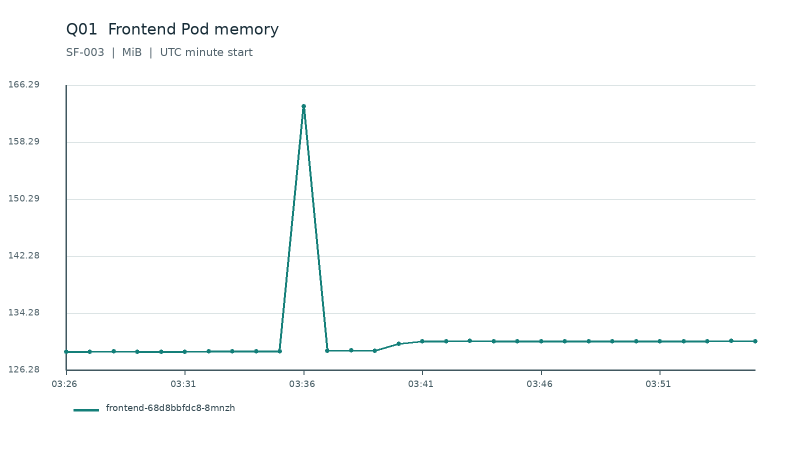
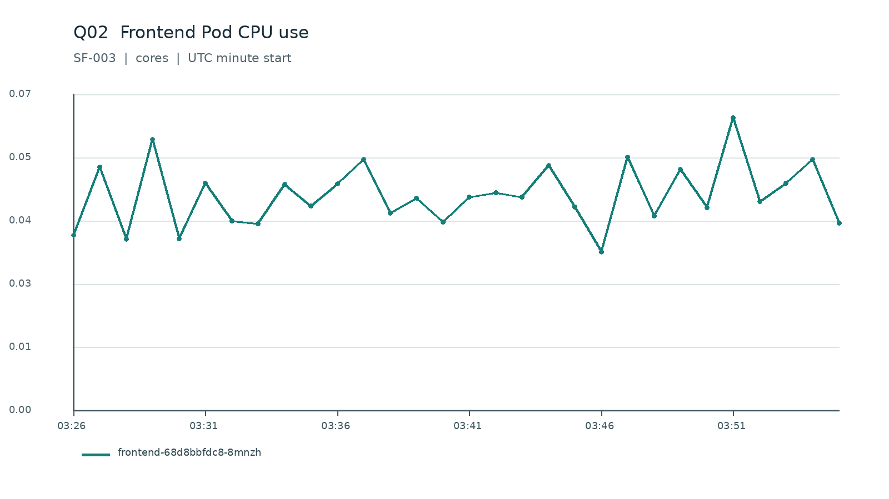
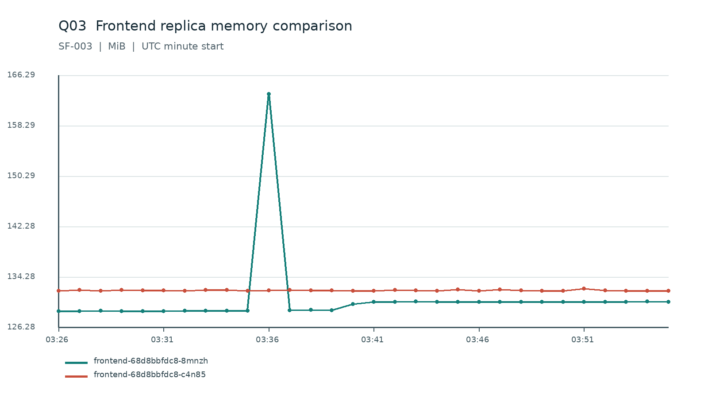
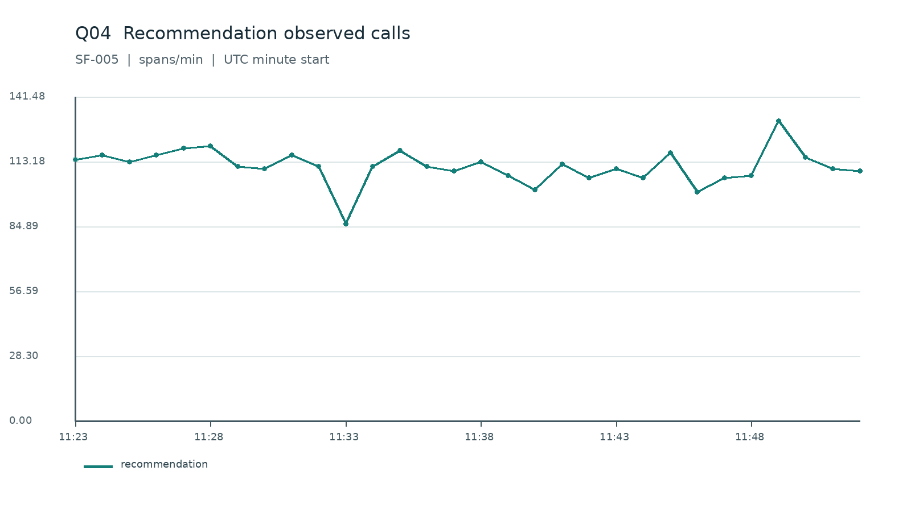
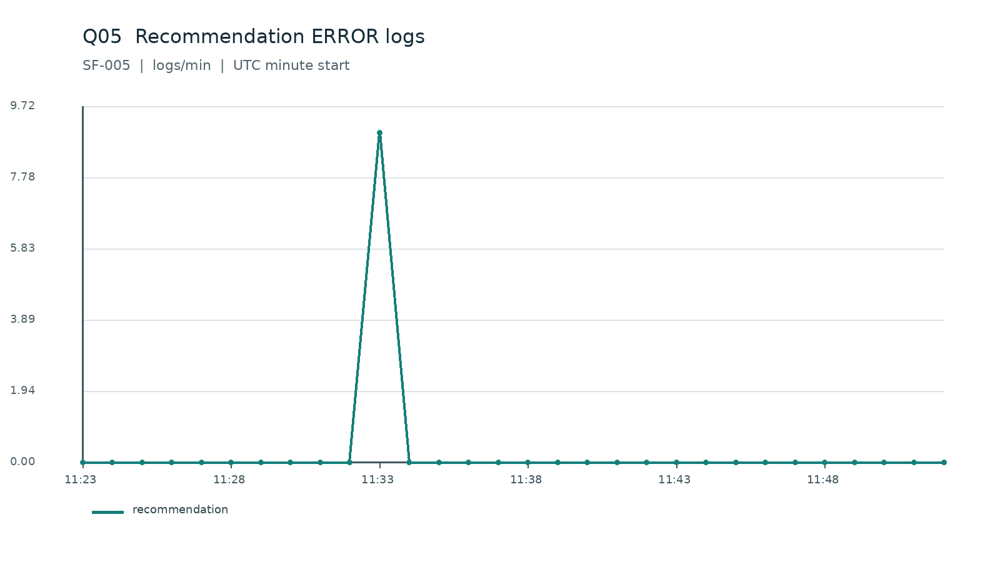
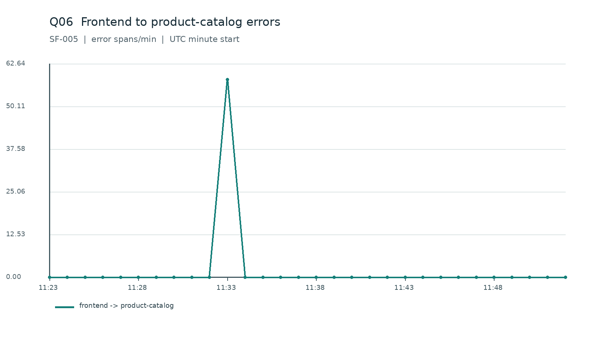
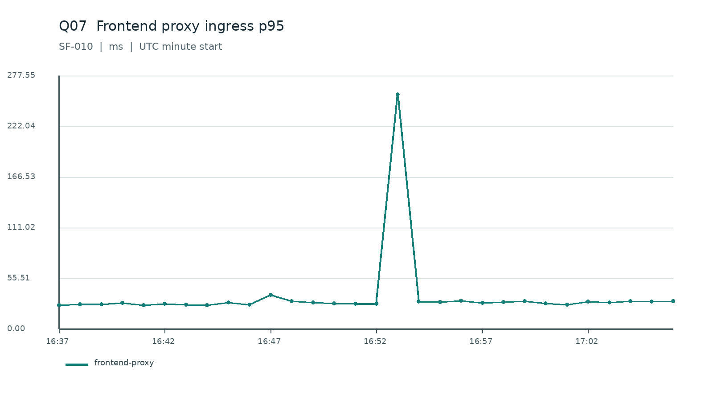
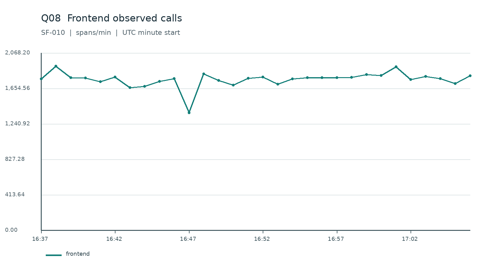
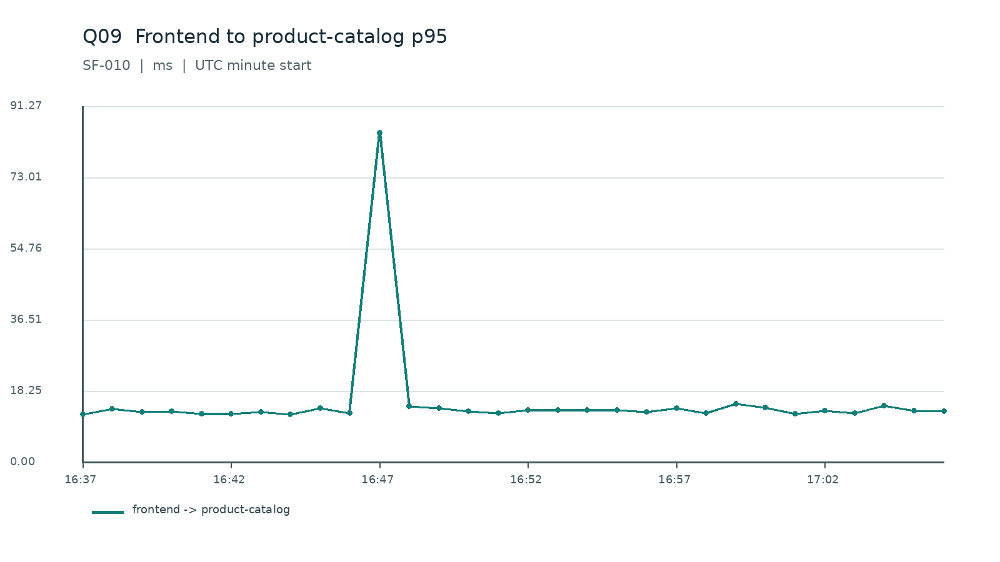
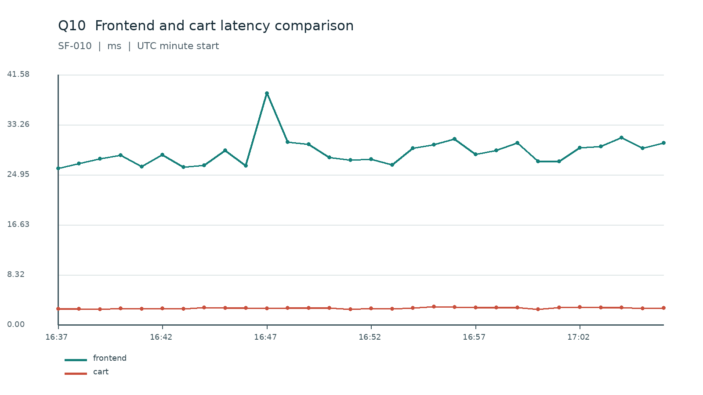

# 半决赛查询绘图候选题审核报告

**状态：READY_FOR_HUMAN_REVIEW；10 道正式候选题、2 道练习示例。**
正式 GT 均为 `DRAFT_PENDING_HUMAN_REVIEW`，未导入比赛服务器或向选手发布。

## 源数据与质量

| Case | 用途 | 冻结 Public 根目录 | 窗口 UTC | Manifest SHA-256 | Metrics / Logs / Spans |
| --- | --- | --- | --- | --- | --- |
| SF-001 | 练习示例 | `/data/stage5-v3/ops-competition-2026/runs/SF-PILOT-01-ATTEMPT-04/public` | 2026-10-14T09:12:25.156656+00:00 至 2026-10-14T10:12:25.156656+00:00 | `8ad8c5eb25e48a33ebf776a40db0f3fbe62284ee7c26df3e4d04139532db0eaa` | 80,358 / 567,346 / 817,529 |
| SF-002 | 练习示例 | `/data/stage5-v3/ops-competition-2026/batch-sf002-sf009/SF-002/public` | 2026-10-14T14:55:28.695044+00:00 至 2026-10-14T15:55:28.695044+00:00 | `458645d012ff5c6ffac1d9676a0275a15ab9da5bac403c1d3f5b3afa5b11011f` | 84,982 / 573,991 / 818,797 |
| SF-003 | 正式候选题 | `/data/stage5-v3/ops-competition-2026/packages/SF-003-ATTEMPT-02/public` | 2026-10-16T03:26:49.724275+00:00 至 2026-10-16T03:56:49.724275+00:00 | `2dda9c2d1cb4dd912df3efe5e5d2dcc8fb9b6ae2505f49f24682d2a2d22b1b8e` | 41,160 / 298,746 / 433,676 |
| SF-005 | 正式候选题 | `/data/stage5-v3/ops-competition-2026/packages/SF-005-ATTEMPT-04/public` | 2026-10-16T11:23:55.458636+00:00 至 2026-10-16T11:53:55.458636+00:00 | `3bddfc396be4bb0a6002d1bbd959c44bf770a692e916dfd5c71da31fafd756f2` | 38,425 / 281,046 / 420,364 |
| SF-010 | 正式候选题 | `/data/stage5-v3/ops-competition-2026/exports/SF-010-ATTEMPT-07/public` | 2026-10-15T16:37:43.727538+00:00 至 2026-10-15T17:07:43.727538+00:00 | `6598702cfb9edd0cd5476de44e46c5c75191f12583c67c34c86e75a6e8d47a96` | 41,581 / 295,980 / 432,558 |

五套 Public Manifest 与其声明的五个文件均已逐项验证 SHA-256 和大小。题目生成和独立复算仅读 Public；Private 注入计划未用于构造答案。

## 统计口径与评分

- 时间桶从 Case 公布的精确起点开始，每桶 60 秒，左闭右开，图上标 UTC 桶起点。
- 内存曲线是 `container_memory_working_set_bytes` 的分钟均值，单位 MiB；CPU Counter 用相邻非负差分除以秒数，异常重置不参与，单位 core。
- 服务数量题统计归档 `span.kind=server` 的 Span，属于**已观测调用数**，不宣称等于全量业务请求。
- p95 在同一分钟至少 20 个有效 Server Span 时取最近秩（升序第 `ceil(0.95*n)` 个）；不足时为 null，不补零。
- ERROR 日志按级别精确匹配；错误调用边按 Server Span `status=ERROR` 计数。计数题空桶为零，其他题缺样本为 null。
- 每题图表 4 分（实体过滤、时间轴、数值口径、单位/图例各 1 分）；三问每题 2 分，总计 10 分。整数容差 0；MiB/ms 数值容差 0.02；CPU core 容差 0.0002；时间题 UTC 桶起点容差 0 秒。

## 十道正式题

| 题号 | Case | 题目 | 目标 | 数据与图 | 难度 |
| --- | --- | --- | --- | --- | --- |
| Q01 | SF-003 | Frontend Pod 内存使用曲线 | frontend-68d8bbfdc8-8mnzh | memory，1 张 60 秒折线图 | BASIC |
| Q02 | SF-003 | Frontend Pod CPU 使用曲线 | frontend-68d8bbfdc8-8mnzh | cpu_rate，1 张 60 秒折线图 | BASIC |
| Q03 | SF-003 | Frontend 两个副本的内存对比 | frontend-68d8bbfdc8-8mnzh, frontend-68d8bbfdc8-c4n85 | memory，1 张 60 秒折线图 | BASIC |
| Q04 | SF-005 | Recommendation 每分钟调用 Span 数量 | recommendation | server_span_count，1 张 60 秒折线图 | BASIC |
| Q05 | SF-005 | Recommendation 错误日志数量 | recommendation | error_log_count，1 张 60 秒折线图 | BASIC |
| Q06 | SF-005 | Frontend 到商品目录的错误调用数量 | frontend -> product-catalog | edge_error_count，1 张 60 秒折线图 | MEDIUM |
| Q07 | SF-010 | Frontend Proxy 入口调用 p95 时延 | frontend-proxy | server_p95，1 张 60 秒折线图 | MEDIUM |
| Q08 | SF-010 | Frontend 每分钟调用 Span 数量 | frontend | server_span_count，1 张 60 秒折线图 | BASIC |
| Q09 | SF-010 | Frontend 到商品目录的调用边 p95 时延 | frontend -> product-catalog | edge_p95，1 张 60 秒折线图 | MEDIUM |
| Q10 | SF-010 | Frontend 与 Cart 调用时延对比 | frontend, cart | server_p95，1 张 60 秒折线图 | INTEGRATED |

难度分布：BASIC 6, INTEGRATED 1, MEDIUM 3。
每题完整 Public JSON 位于 `public/questions/`；以下答案仅供组委会内部审核。

### Q01 · Frontend Pod 内存使用曲线

Case `SF-003`；目标 `frontend-68d8bbfdc8-8mnzh`；模态 Metrics；窗口 `2026-10-16T03:26:49.724275+00:00` 至 `2026-10-16T03:56:49.724275+00:00`（右端不含）。

绘图：line，横轴 UTC bucket start，纵轴 MiB；查询过滤 `{'entities': ['frontend-68d8bbfdc8-8mnzh'], 'metric_name': 'container_memory_working_set_bytes', 'container': 'frontend'}`，聚合 `mean(value) / 1048576 by 60-second bucket`。

1. 整段时间内，最高的每分钟均值是多少（单位 MiB）？ **163.33 MiB**。计算：max of valid minute values；容差 0.02，时间容差 0 秒。
2. 最高值出现在哪个 UTC 分钟起点？若并列，取最早一分钟。 **2026-10-16T03:36:49.724275+00:00 UTC**。计算：earliest maximum minute start；容差 None，时间容差 0 秒。
3. 整段时间内所有有效分钟值的算术平均是多少（单位 MiB）？ **130.81 MiB**。计算：unweighted mean of valid minute values；容差 0.02，时间容差 0 秒。

真实逐分钟绘图数据：`private/ground-truth/Q01-gt.json` 的 `canonical_chart_data`；同文件保留真实 Public 记录样本和评分细则。

### Q02 · Frontend Pod CPU 使用曲线

Case `SF-003`；目标 `frontend-68d8bbfdc8-8mnzh`；模态 Metrics；窗口 `2026-10-16T03:26:49.724275+00:00` 至 `2026-10-16T03:56:49.724275+00:00`（右端不含）。

绘图：line，横轴 UTC bucket start，纵轴 cores；查询过滤 `{'entities': ['frontend-68d8bbfdc8-8mnzh'], 'metric_name': 'container_cpu_usage_seconds_total', 'container': 'frontend'}`，聚合 `mean(max(0, counter_delta) / elapsed_seconds) by later-sample 60-second bucket`。

1. 整段时间内，最高的每分钟均值是多少（单位 cores）？ **0.0628 cores**。计算：max of valid minute values；容差 0.0002，时间容差 0 秒。
2. 最高值出现在哪个 UTC 分钟起点？若并列，取最早一分钟。 **2026-10-16T03:51:49.724275+00:00 UTC**。计算：earliest maximum minute start；容差 None，时间容差 0 秒。
3. 整段时间内所有有效分钟值的算术平均是多少（单位 cores）？ **0.0461 cores**。计算：unweighted mean of valid minute values；容差 0.0002，时间容差 0 秒。

真实逐分钟绘图数据：`private/ground-truth/Q02-gt.json` 的 `canonical_chart_data`；同文件保留真实 Public 记录样本和评分细则。

### Q03 · Frontend 两个副本的内存对比

Case `SF-003`；目标 `['frontend-68d8bbfdc8-8mnzh', 'frontend-68d8bbfdc8-c4n85']`；模态 Metrics；窗口 `2026-10-16T03:26:49.724275+00:00` 至 `2026-10-16T03:56:49.724275+00:00`（右端不含）。

绘图：line，横轴 UTC bucket start，纵轴 MiB；查询过滤 `{'entities': ['frontend-68d8bbfdc8-8mnzh', 'frontend-68d8bbfdc8-c4n85'], 'metric_name': 'container_memory_working_set_bytes', 'container': 'frontend'}`，聚合 `mean(value) / 1048576 by 60-second bucket`。

1. 哪一个实体的整段有效分钟值均值更高：frontend-68d8bbfdc8-8mnzh 还是 frontend-68d8bbfdc8-c4n85？ **frontend-68d8bbfdc8-c4n85 entity ID**。计算：compare unweighted means of valid minutes；容差 None，时间容差 0 秒。
2. 两条曲线的整段分钟均值相差多少（绝对值，单位 MiB）？ **1.34 MiB**。计算：absolute difference of per-series minute means；容差 0.02，时间容差 0 秒。
3. 两条曲线的差距（绝对值）最大时，UTC 分钟起点是什么？若并列，取最早一分钟。 **2026-10-16T03:36:49.724275+00:00 UTC**。计算：earliest maximum absolute per-minute difference；容差 None，时间容差 0 秒。

真实逐分钟绘图数据：`private/ground-truth/Q03-gt.json` 的 `canonical_chart_data`；同文件保留真实 Public 记录样本和评分细则。

### Q04 · Recommendation 每分钟调用 Span 数量

Case `SF-005`；目标 `recommendation`；模态 Traces；窗口 `2026-10-16T11:23:55.458636+00:00` 至 `2026-10-16T11:53:55.458636+00:00`（右端不含）。

绘图：line，横轴 UTC bucket start，纵轴 spans/min；查询过滤 `{'entities': ['recommendation'], 'span_kind': 'server'}`，聚合 `count matching server Spans by 60-second bucket`。

1. 整段时间内共有多少条符合条件的 服务端 Span？ **3331 spans**。计算：sum of all 60-second bucket counts；容差 0，时间容差 0 秒。
2. 数量最多的一分钟有多少条 服务端 Span？ **131 spans**。计算：maximum minute count；容差 0，时间容差 0 秒。
3. 数量最多的分钟起点 UTC 是什么？若并列，取最早一分钟。 **2026-10-16T11:49:55.458636+00:00 UTC**。计算：earliest maximum minute start；容差 None，时间容差 0 秒。

真实逐分钟绘图数据：`private/ground-truth/Q04-gt.json` 的 `canonical_chart_data`；同文件保留真实 Public 记录样本和评分细则。

### Q05 · Recommendation 错误日志数量

Case `SF-005`；目标 `recommendation`；模态 Logs；窗口 `2026-10-16T11:23:55.458636+00:00` 至 `2026-10-16T11:53:55.458636+00:00`（右端不含）。

绘图：line，横轴 UTC bucket start，纵轴 logs/min；查询过滤 `{'entities': ['recommendation'], 'severity': 'ERROR (case-insensitive exact match)'}`，聚合 `count matching log records by 60-second bucket`。

1. 整段时间内共有多少条符合条件的 ERROR 日志？ **9 logs**。计算：sum of all 60-second bucket counts；容差 0，时间容差 0 秒。
2. 数量最多的一分钟有多少条 ERROR 日志？ **9 logs**。计算：maximum minute count；容差 0，时间容差 0 秒。
3. 数量最多的分钟起点 UTC 是什么？若并列，取最早一分钟。 **2026-10-16T11:33:55.458636+00:00 UTC**。计算：earliest maximum minute start；容差 None，时间容差 0 秒。

真实逐分钟绘图数据：`private/ground-truth/Q05-gt.json` 的 `canonical_chart_data`；同文件保留真实 Public 记录样本和评分细则。

### Q06 · Frontend 到商品目录的错误调用数量

Case `SF-005`；目标 `frontend -> product-catalog`；模态 Traces；窗口 `2026-10-16T11:23:55.458636+00:00` 至 `2026-10-16T11:53:55.458636+00:00`（右端不含）。

绘图：line，横轴 UTC bucket start，纵轴 error spans/min；查询过滤 `{'entities': ['frontend -> product-catalog'], 'span_kind': 'server', 'status': 'ERROR (case-insensitive exact match)'}`，聚合 `count matching server Spans by 60-second bucket`。

1. 整段时间内共有多少条错误调用边 Span（单位 error spans）？ **58 error spans**。计算：sum of all minute error-span counts；容差 0，时间容差 0 秒。
2. 错误 Span 数量最多的分钟起点 UTC 是什么？若并列，取最早一分钟。 **2026-10-16T11:33:55.458636+00:00 UTC**。计算：earliest maximum minute start；容差 None，时间容差 0 秒。
3. 从 11:33:55 UTC 起的 5 分钟总数减去从 11:23:55 UTC 起的 5 分钟总数，差是多少（单位 error spans）？ **58 error spans**。计算：second five-minute count minus first five-minute count；容差 0，时间容差 0 秒。

真实逐分钟绘图数据：`private/ground-truth/Q06-gt.json` 的 `canonical_chart_data`；同文件保留真实 Public 记录样本和评分细则。

### Q07 · Frontend Proxy 入口调用 p95 时延

Case `SF-010`；目标 `frontend-proxy`；模态 Traces；窗口 `2026-10-15T16:37:43.727538+00:00` 至 `2026-10-15T17:07:43.727538+00:00`（右端不含）。

绘图：line，横轴 UTC bucket start，纵轴 ms；查询过滤 `{'entities': ['frontend-proxy'], 'span_kind': 'server', 'operation_name': 'ingress'}`，聚合 `nearest-rank p95 of valid duration_ms in each bucket`。

1. 整段时间内，最高的每分钟 p95 是多少（单位 ms）？ **256.99 ms**。计算：max of minute nearest-rank p95 values；容差 0.02，时间容差 0 秒。
2. 最高值出现在哪个 UTC 分钟起点？若并列，取最早一分钟。 **2026-10-15T16:53:43.727538+00:00 UTC**。计算：earliest maximum minute start；容差 None，时间容差 0 秒。
3. 从 16:52:43 UTC 起的 5 个分钟 p95 的均值，减去从 16:37:43 UTC 起的 5 个分钟 p95 的均值，差是多少（单位 ms）？ **48.03 ms**。计算：unweighted mean of five p95 values: second window minus first；容差 0.02，时间容差 0 秒。

真实逐分钟绘图数据：`private/ground-truth/Q07-gt.json` 的 `canonical_chart_data`；同文件保留真实 Public 记录样本和评分细则。

### Q08 · Frontend 每分钟调用 Span 数量

Case `SF-010`；目标 `frontend`；模态 Traces；窗口 `2026-10-15T16:37:43.727538+00:00` 至 `2026-10-15T17:07:43.727538+00:00`（右端不含）。

绘图：line，横轴 UTC bucket start，纵轴 spans/min；查询过滤 `{'entities': ['frontend'], 'span_kind': 'server'}`，聚合 `count matching server Spans by 60-second bucket`。

1. 整段时间内共有多少条符合条件的 服务端 Span？ **52753 spans**。计算：sum of all 60-second bucket counts；容差 0，时间容差 0 秒。
2. 数量最多的一分钟有多少条 服务端 Span？ **1915 spans**。计算：maximum minute count；容差 0，时间容差 0 秒。
3. 数量最多的分钟起点 UTC 是什么？若并列，取最早一分钟。 **2026-10-15T16:38:43.727538+00:00 UTC**。计算：earliest maximum minute start；容差 None，时间容差 0 秒。

真实逐分钟绘图数据：`private/ground-truth/Q08-gt.json` 的 `canonical_chart_data`；同文件保留真实 Public 记录样本和评分细则。

### Q09 · Frontend 到商品目录的调用边 p95 时延

Case `SF-010`；目标 `frontend -> product-catalog`；模态 Traces；窗口 `2026-10-15T16:37:43.727538+00:00` 至 `2026-10-15T17:07:43.727538+00:00`（右端不含）。

绘图：line，横轴 UTC bucket start，纵轴 ms；查询过滤 `{'entities': ['frontend -> product-catalog'], 'span_kind': 'server'}`，聚合 `nearest-rank p95 of valid duration_ms in each bucket`。

1. 整段时间内，最高的每分钟 p95 是多少（单位 ms）？ **84.51 ms**。计算：max of minute nearest-rank p95 values；容差 0.02，时间容差 0 秒。
2. 最高值出现在哪个 UTC 分钟起点？若并列，取最早一分钟。 **2026-10-15T16:47:43.727538+00:00 UTC**。计算：earliest maximum minute start；容差 None，时间容差 0 秒。
3. 从 16:47:43 UTC 起的 5 个分钟 p95 的均值，减去从 16:37:43 UTC 起的 5 个分钟 p95 的均值，差是多少（单位 ms）？ **14.77 ms**。计算：unweighted mean of five p95 values: second window minus first；容差 0.02，时间容差 0 秒。

真实逐分钟绘图数据：`private/ground-truth/Q09-gt.json` 的 `canonical_chart_data`；同文件保留真实 Public 记录样本和评分细则。

### Q10 · Frontend 与 Cart 调用时延对比

Case `SF-010`；目标 `['frontend', 'cart']`；模态 Traces；窗口 `2026-10-15T16:37:43.727538+00:00` 至 `2026-10-15T17:07:43.727538+00:00`（右端不含）。

绘图：line，横轴 UTC bucket start，纵轴 ms；查询过滤 `{'entities': ['frontend', 'cart'], 'span_kind': 'server'}`，聚合 `nearest-rank p95 of valid duration_ms in each bucket`。

1. 哪一个实体的整段有效分钟值均值更高：frontend 还是 cart？ **frontend entity ID**。计算：compare unweighted means of valid minutes；容差 None，时间容差 0 秒。
2. 两条曲线的整段分钟均值相差多少（绝对值，单位 ms）？ **25.93 ms**。计算：absolute difference of per-series minute means；容差 0.02，时间容差 0 秒。
3. 两条曲线的差距（绝对值）最大时，UTC 分钟起点是什么？若并列，取最早一分钟。 **2026-10-15T16:47:43.727538+00:00 UTC**。计算：earliest maximum absolute per-minute difference；容差 None，时间容差 0 秒。

真实逐分钟绘图数据：`private/ground-truth/Q10-gt.json` 的 `canonical_chart_data`；同文件保留真实 Public 记录样本和评分细则。

### EX-P01 · 练习示例：Frontend Pod 内存

Case `SF-001`；目标 `frontend-68d8bbfdc8-8mnzh`；模态 Metrics；窗口 `2026-10-14T09:12:25.156656+00:00` 至 `2026-10-14T10:12:25.156656+00:00`（右端不含）。

绘图：line，横轴 UTC bucket start，纵轴 MiB；查询过滤 `{'entities': ['frontend-68d8bbfdc8-8mnzh'], 'metric_name': 'container_memory_working_set_bytes', 'container': 'frontend'}`，聚合 `mean(value) / 1048576 by 60-second bucket`。

1. 整段时间内，最高的每分钟均值是多少（单位 MiB）？ **161.71 MiB**。计算：max of valid minute values；容差 0.02，时间容差 0 秒。
2. 最高值出现在哪个 UTC 分钟起点？若并列，取最早一分钟。 **2026-10-14T09:51:25.156656+00:00 UTC**。计算：earliest maximum minute start；容差 None，时间容差 0 秒。
3. 整段时间内所有有效分钟值的算术平均是多少（单位 MiB）？ **130.59 MiB**。计算：unweighted mean of valid minute values；容差 0.02，时间容差 0 秒。

真实逐分钟绘图数据：`private/ground-truth/EX-P01-gt.json` 的 `canonical_chart_data`；同文件保留真实 Public 记录样本和评分细则。

### EX-P02 · 练习示例：Recommendation 错误日志

Case `SF-002`；目标 `recommendation`；模态 Logs；窗口 `2026-10-14T14:55:28.695044+00:00` 至 `2026-10-14T15:55:28.695044+00:00`（右端不含）。

绘图：line，横轴 UTC bucket start，纵轴 logs/min；查询过滤 `{'entities': ['recommendation'], 'severity': 'ERROR (case-insensitive exact match)'}`，聚合 `count matching log records by 60-second bucket`。

1. 整段时间内共有多少条符合条件的 ERROR 日志？ **195 logs**。计算：sum of all 60-second bucket counts；容差 0，时间容差 0 秒。
2. 数量最多的一分钟有多少条 ERROR 日志？ **195 logs**。计算：maximum minute count；容差 0，时间容差 0 秒。
3. 数量最多的分钟起点 UTC 是什么？若并列，取最早一分钟。 **2026-10-14T15:12:28.695044+00:00 UTC**。计算：earliest maximum minute start；容差 None，时间容差 0 秒。

真实逐分钟绘图数据：`private/ground-truth/EX-P02-gt.json` 的 `canonical_chart_data`；同文件保留真实 Public 记录样本和评分细则。

## 可回答性与独立复算

12/12 题目均通过第二套独立 PyArrow 分批求解：每个图表点的 UTC、实体、样本数和数值均与 GT 一致；36/36 个答案复算一致。每张 PNG 可打开，10 道正式题均有恰好三问，分值均为 10。
具体机器结果位于 `validation/reproducibility-results.json`。源指标与分钟覆盖盘点位于 `validation/source-inventory.json` 和 `validation/spec-dry-run.json`。

## Public / Private 边界与导入说明

- `public/questions/Q01.json` 至 `Q10.json` 只含题面、实体、时间窗、数据过滤、绘图要求与三问；不含答案、GT、注入类型。
- 练习示例 `EX-P01/EX-P02` 的已解答题面与参考图只在 `public/PLAYER_MANUAL.md`、`public/PLAYER_MANUAL_QUERY_EXAMPLES.md` 和 `public/manual-assets/` 中公开。
- 正式 GT、参考图与审核表只在权限 0700 的 `private/`；GT 一律保持草案状态。根目录 `sha256-manifest.json` 列出所有交付文件哈希。
- Public 与 Private JSON Schema 分别位于 `public/schemas/question.schema.json`、`private/schemas/gt.schema.json`，12/12 文件已通过 Schema 校验。
- 50/51 的 `SEMIFINAL_QUERY_VISUALIZATION` Question API、Demo Agent 和评分接口仍在升级；本任务未访问 50/51，因此只提供可导入数据结构，不宣称接口已适配或上线。
- Master 未发现现有选手手册源文件；已生成独立的 Public 选手手册增补草案与可并入章节，待拿到正式手册源路径后再合并，当前未发布。

人工审核前不得将任何正式 GT 设为 APPROVED，也不得把 Private 标准答案复制到 Public 包。

## 每题求解入口

12/12 个 `validation/reference-solvers/<ID>.py` 已独立运行通过。每个入口先写出 Public-only 解题结果和独立图表，之后才读取 Private GT 比对；各自的 `*-public-solution.json`、`*-check.json` 和图表均保留。
