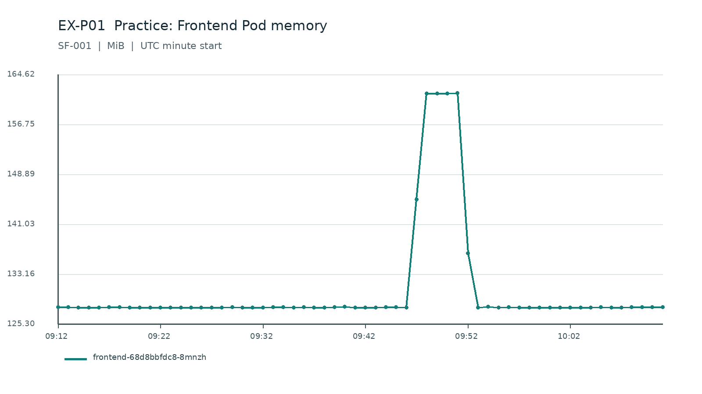
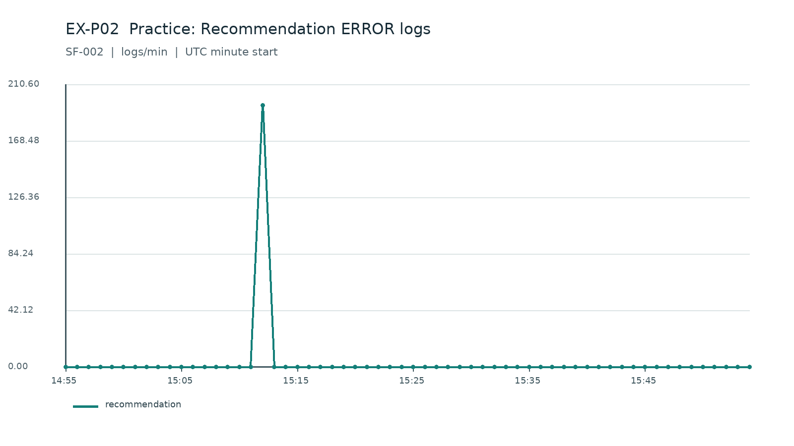

# 选手手册：查询与绘图练习示例

仅使用 SF-001、SF-002 的练习 Public 数据；这两题已给出答案，不属于正式 Q01～Q10。
实际 Question API 尚未在本任务中核验；按题面所列的 Public 字段过滤、分桶和绘图，不虚构接口 URL。

## EX-P01 · SF-001 · 练习示例：Frontend Pod 内存

实体：frontend-68d8bbfdc8-8mnzh；数据：metrics.parquet；窗口：2026-10-14T09:12:25.156656+00:00 至 2026-10-14T10:12:25.156656+00:00（右端不含）。

口径：`mean(value) / 1048576 by 60-second bucket`；每个时间点为 60 秒桶起点。采样不足的分钟保留为空值，不补零。

1. 整段时间内，最高的每分钟均值是多少（单位 MiB）？ **161.71 MiB**。
2. 最高值出现在哪个 UTC 分钟起点？若并列，取最早一分钟。 **2026-10-14T09:51:25.156656+00:00 UTC**。
3. 整段时间内所有有效分钟值的算术平均是多少（单位 MiB）？ **130.59 MiB**。

把符合过滤条件的记录按 60 秒分桶，计算各分钟数值，从同一条时序曲线读取答案；时间题使用 UTC 桶起点。

## EX-P02 · SF-002 · 练习示例：Recommendation 错误日志

实体：recommendation；数据：logs.parquet；窗口：2026-10-14T14:55:28.695044+00:00 至 2026-10-14T15:55:28.695044+00:00（右端不含）。

口径：`count matching log records by 60-second bucket`；每个时间点为 60 秒桶起点。没有符合条件日志的分钟记为 0。

1. 整段时间内共有多少条符合条件的 ERROR 日志？ **195 条**。
2. 数量最多的一分钟有多少条 ERROR 日志？ **195 条**。
3. 数量最多的分钟起点 UTC 是什么？若并列，取最早一分钟。 **2026-10-14T15:12:28.695044+00:00 UTC**。

把符合过滤条件的记录按 60 秒分桶，计算各分钟数值，从同一条时序曲线读取答案；时间题使用 UTC 桶起点。
